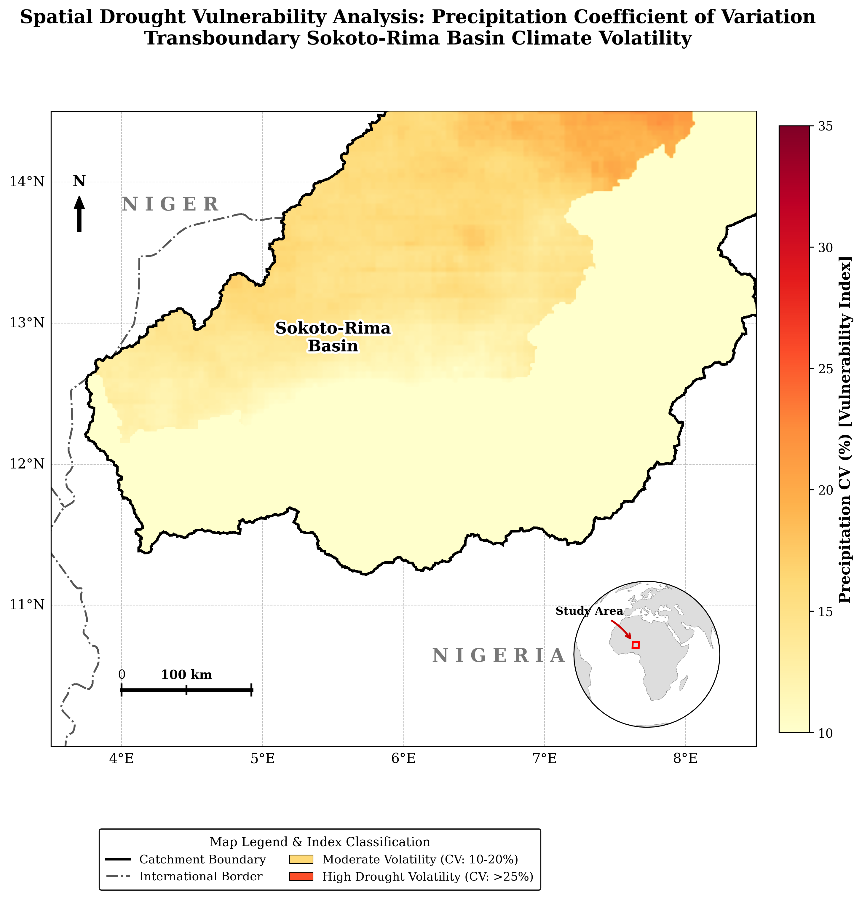
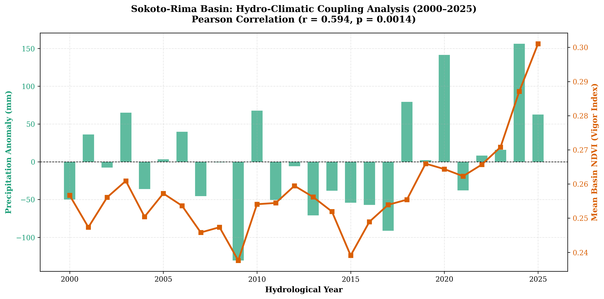

# Cloud-Native Observational Hydrology in Data-Sparse Catchments

**Author:** David Oloyede  
**Specialization:** Environmental Remote Sensing & Geospatial Information Systems  

---

## Overview

Across West Africa, ground-based weather and river monitoring stations are sparse just as climate extremes are intensifying. This project addresses that data gap through a two-part, cloud-native Earth Observation portfolio modeling opposite ends of the regional water cycle across transboundary river basins:

* **Part A — Flood Hydrodynamics (Lower Niger-Benue Basin):** Uses Sentinel-1 Synthetic Aperture Radar (SAR) and MERIT DEM topography to bypass heavy monsoon cloud cover, mapping seasonal flood-pulse propagation, 5-year inundation frequency, and floodplain vulnerability hotspots.

* **Part B — Drought & Eco-Hydrological Coupling (Sokoto-Rima Basin):** Integrates over four decades of CHIRPS precipitation and MODIS NDVI time-series across the semi-arid Sudano-Sahelian zone to quantify rainfall volatility (CV), Standardized Precipitation Index (SPI) drought regimes, and vegetation-climate coupling ($r = 0.594, p = 0.0014$).

---

## Complete Portfolio Documentation

* **Full Written Report (Part A & Part B Combined):** [View Complete PDF](documents/Observational%20Hydrology%20in%20Data-Sparse%20Catchments%20A%20AND%20B.pdf)

---

## Module-by-Module Code Execution (Google Colab)

The analytical pipelines for this research are hosted in interactive Google Colab environments for browser-based reproduction.

* **Part A (Lower Niger-Benue Basin):** Sentinel-1 SAR flood pulse extraction, inundation frequency, and hydro-geomorphic vulnerability.  
  [Open Part A Colab Notebook](https://colab.research.google.com/drive/1-j9tGSStRQJyD_uylA_-HPH7nATFKGX8#scrollTo=kYW3s4lnvw7a)

* **Part B (Sokoto-Rima Basin):** Multi-decadal precipitation CV vulnerability, SPI meteorological drought classification, and MODIS NDVI eco-hydrological coupling ($r = 0.594, p = 0.0014$).  
  [Open Part B Colab Notebook](https://colab.research.google.com/drive/1_Em3EWTjQ9zbgQWf3ppezo_V_6Vpfbyt)

---

## Selected Visual Synthesis

Below is a curated preview showing 4 of the 14 cartographic maps and statistical plots produced in this study. The complete figure sets are embedded in the full PDF report and archived in the [Part A Figures (6 outputs)](part_a/figures/) and [Part B Figures (8 outputs)](part_b/figures/) folders.

| Part A: Niger-Benue Flood Hydrodynamics | Part B: Sokoto-Rima Drought Dynamics |
| :---: | :---: |
|    *Sentinel-1 SAR Dual-State Inundation* |    *Multi-Decadal Precipitation CV Vulnerability* |
|    *Empirical Catchment Seasonal Flood Pulse* |    *MODIS NDVI & Rainfall Eco-Hydrological Coupling* |

---

## Methodological Architecture & Technical Stack

| Pipeline Stage | Core Analytical Process | Technologies & Sensor Archives |
| :--- | :--- | :--- |
| **01 / Cloud Ingestion** | Server-side spatial and temporal reduction, radar speckle filtering, and optical cloud masking. | `Google Earth Engine API` · `Sentinel-1 SAR` · `CHIRPS` · `MODIS MOD13Q1` |
| **02 / Terrain & Array Modeling** | Backscatter water thresholding, drainage height normalization, and floodplain cross-section profiling. | `Rasterio` · `GeoPandas` · `Shapely` · `MERIT DEM` · `WWF HydroSHEDS` |
| **03 / Statistical Diagnostics** | Standardized anomaly indexing (`SPI` and `NDVI` Z-scores), spatial `CV` surfaces, and correlation modeling. | `SciPy` · `NumPy` · `Pandas` |
| **04 / Cartographic Synthesis** | Multi-panel planar projection rendering, seasonal flood-pulse curves, and vulnerability mapping. | `Cartopy` · `Matplotlib` · `QGIS` · `ArcGIS Pro` |

---

## Research Reflection

Working on hydrological problems in Nigeria quickly forces you to deal with missing ground data. River gauges are sparse, and during the peak rainy season, heavy cloud cover makes standard optical satellite imagery almost useless for tracking floods. Putting these two workflows together was a practical way to work around those limits. Pairing radar data in the south with long-term rainfall and vegetation records in the north showed me how much insight we can pull from public satellite archives when local monitoring networks fall short. 
